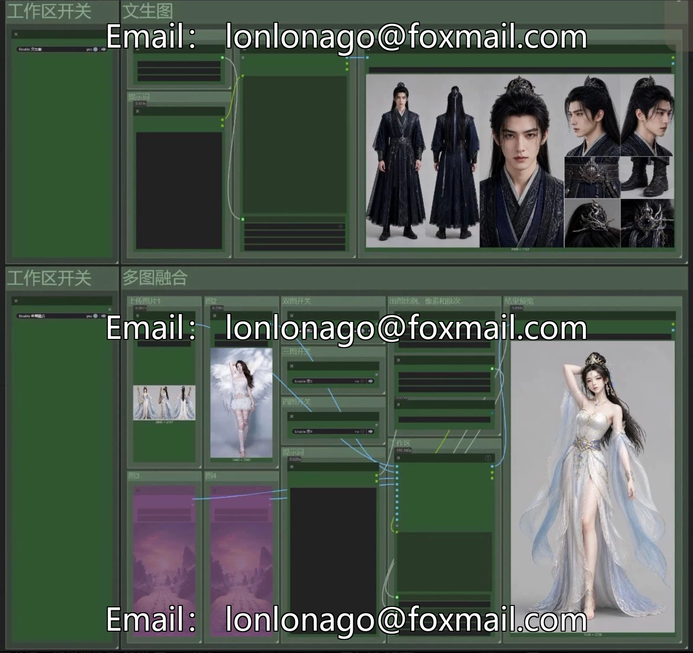
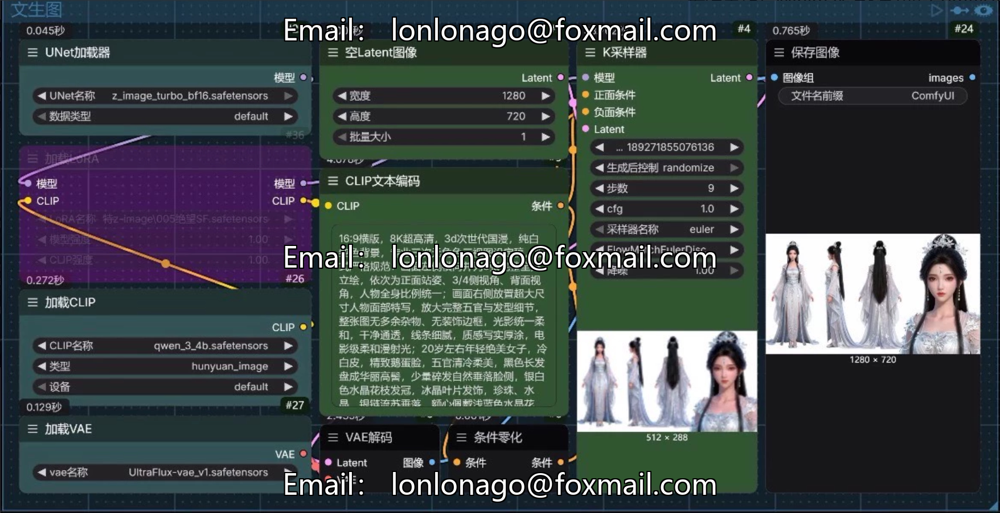
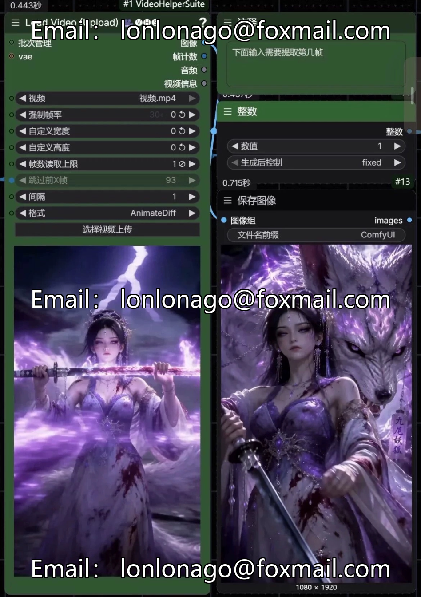
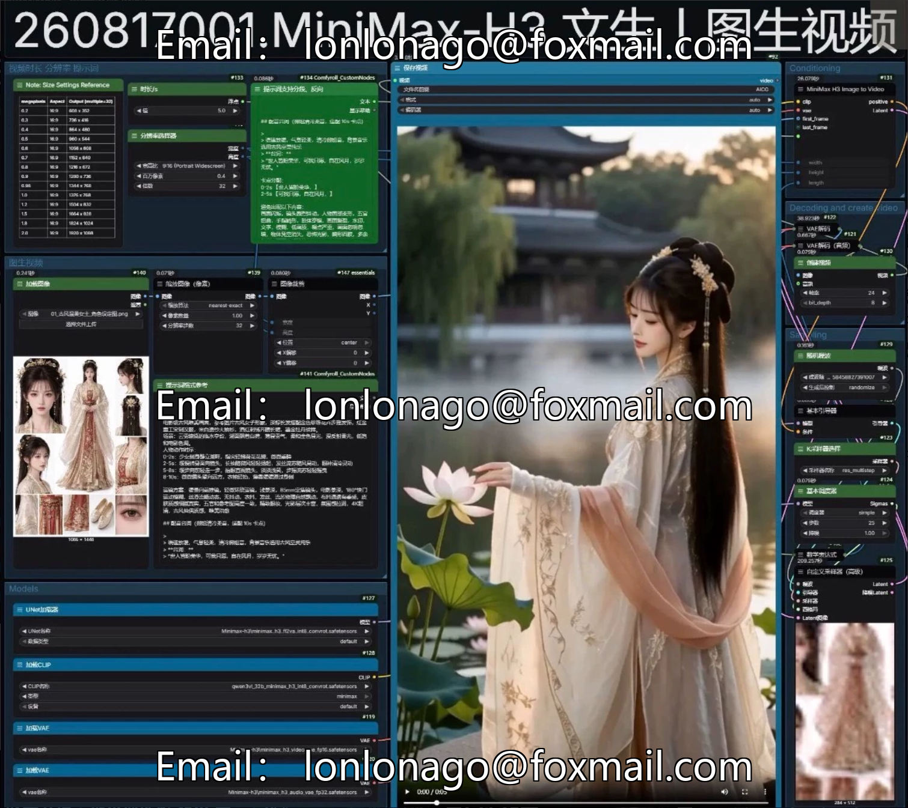
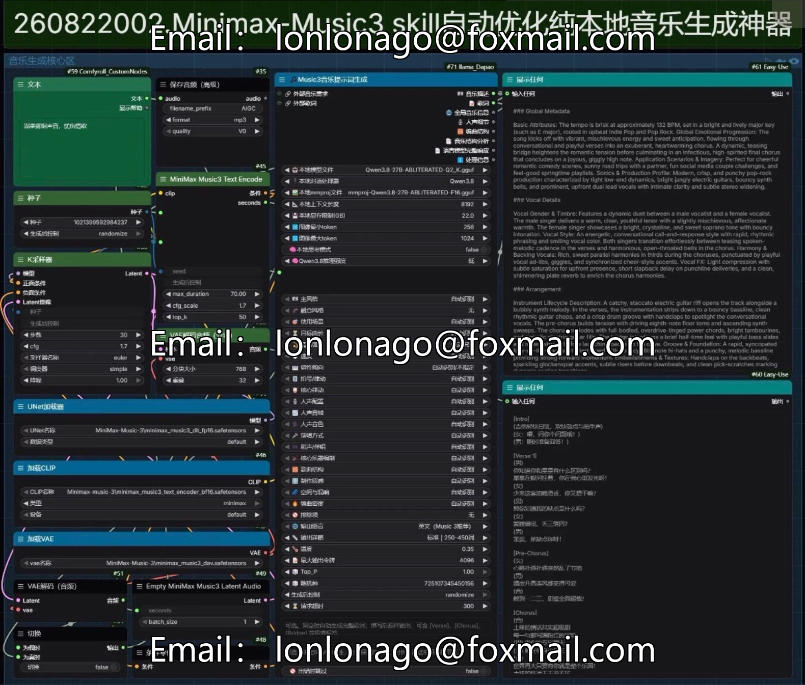
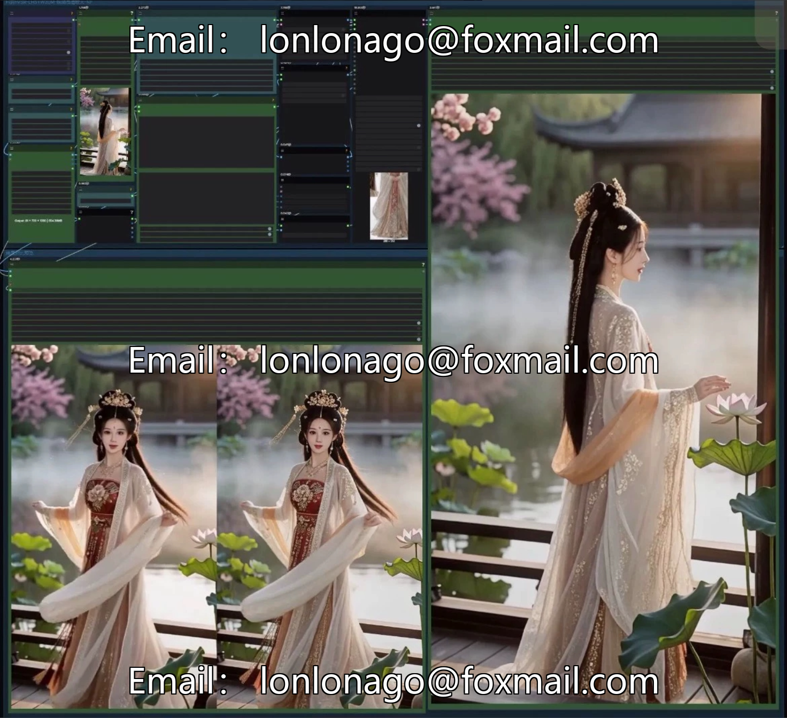

# The Ultimate King's Hand! Minimax-H3 Full Functional ComfyUI Integration Pack 1

## Body

The Ultimate King's Hand! Minimax-H3 Full-Feature ComfyUI Integration Pack with 19 Workflows, Live Graphics Video Full Chain, and Instructional Guide.

By August 2026, a full logic integration is achieved based on the Minimax-H3 video model. After in-depth debugging, multiple rounds of real-machine testing have verified its stability without any errors. The model and plugin are fully compatible. It covers all scenarios including prompt word optimization, live image creation, image editing, video generation, and image enhancement. A one-stop local AI creation workstation is built. A systematic workflow list and detailed tutorials are provided to facilitate quick learning and subsequent optimization. Additionally, an online operation plan is offered, allowing for normal use even with limited local hardware.

Core advantages of the integrated package

1. Full-featured workflow coverage: 19 sets of finished workflows are fully integrated, covering core functions such as prompt word processing, text-to-image, image editing, picture enhancement, text-to-video, image-to-video, all-in-one reference to video, and high-definition enlargement, building a complete local creative workflow.

2. Comprehensive Learning System: Includes a workflow checklist table that systematically organizes the work flow, with clear functional classification. Detailed deployment tutorials with label updates and node positioning of the assets case, facilitating overall learning, self-deployment, and subsequent optimization.

3. Dual Operational Scheme Support: Local Deployment + Online Operational Scheme, when local hardware performance is insufficient, the online scheme can be used, and all full-function processes can run normally.

19 workflow detail

Prompt words and foundational life sciences

0. SKILL prompt assistant: local back-propagation of prompt workflow, calling SKILL skills to complete prompt inference optimization, local operation with no limit on the amount of data, improving the efficiency of creative work.

1. Z-Image+lora Wensheng Graph: The workflow based on the Z-image model for Wensheng graphs, with stable image representation and the ability to quickly generate reference graphic materials.

2. Automated optimization of prompt word-based image generation + washing: first infer the prompt words of the scene, then generate original images based on the prompt words to adapt to scenes without inspiration.

3. Extract specific frames from a video: Precisely extracting the frames of a video, often used for extracting keyframes and starting/ending frames.

4. RMBG2.0 One-Click Image Retouching: Precisely removes the background of an image, simultaneously generates a mask area, and is suitable for various material processing needs.

Image editing and beautification

5. Image 4K High-Definition Magnification: Intelligently enlarges low-resolution images to enhance picture clarity and details, adapting to small-sized materials for optimization.

6. Portrait De-skinning and Refinement: Supports portrait skin smoothing, whitening, and blemish repair to maintain consistency of the portrait's features.

7. Qwen Tri-Image Integration: Capable of image editing, capable of adjusting characters' poses, actions, and scenes, suitable for shot composition creation.

8. Qwen facial workflow: Generate new character appearances based on facial references, ensuring consistency in facial features.

9. Qwen_2511 Multi-angle Control: Precisely control the angle of character generation to achieve consistent output of multi-angle character scenes.

10. Lighting Remap: A lighting tool that allows customization of light source position and color, enhancing the visual atmosphere and texture of the scene.

Video generation core class

8. MiniMax-H3 All-in-One Reference Rapid Video Generation: Core video generation workflow, supports multiple reference inputs, highlights in efficiency generation.

9. MiniMax-H3 Video | Frame Generation: Precise control of video start and end frames, achieving natural transition effects.

10. MiniMax H3 Video: Single Image Driven Generation of Dynamic Video, Fits Static Materials with Animation Effects

11. MiniMax-H3 Multi-Image + All-in-One Reference Video Generation: 15s with Workbench Layout for Multi-Reference Video Generation, Suitable for Medium to Long Segments

12. (High Graphics Card) Auto-Optimized Local Model Suggestions for Minimax-H3: Integrated Qwen3.8 inference model optimization suggestions, can run with high graphics card configuration.

13. Video Optimization and Repair: Optimize the video quality for short videos, enhancing clarity and texture.

14. FlashVSR Video High Definition Magnification: Intelligently magnifies and enhances low-resolution videos, highlighting short segments, and adapts to the quality of video materials for improvement.

Audio creation

13. (High Graphics Card) Minimax-Music3 skill automatic optimization for pure local music generation: Local inference model generates music based on requirements, high graphics card configuration can be tested for operation.

Optional value-added workflows

• G.i2 High-Quality Character Scenery Renders: The direction of character design is outstanding, offering an online paid workflow that can be selected as needed. The corresponding entry is delivered along with the resources.

Run configuration requirements

• System: Windows 10 and above versions

• Graphics Card: Only supports NVIDIA dedicated graphics cards, and a minimum of 12GB or more memory recommended for basic video generation; higher-memory work flows require higher configurations.

• Memory: 16G or more RAM

• Storage: Reserve sufficient solid-state drive space for storing the model and environment files.

Shipping Instructions

•

• Includes a complete workflow, associated plugins, tutorial documents, and a workflow checklist table.

• Online operation plan entry is delivered with the resource package.

Purchase Notice

1. This product is a virtual digital resource, and it is replicable. Once shipped, non-file damage issues will not be accepted. Please confirm your requirements and hardware configuration before placing an order.

2. The resources are for personal study and research only. Please comply with relevant open-source agreements and laws and regulations, and prohibit reselling, disassembling and distributing, and illegal commercial use.

3. Some high-memory work flows require higher hardware requirements, and should be selected based on their own configuration. The actual generation effect is subject to the local performance.

4. G.i2-related online services are third-party channels, only providing access guidance. Relevant rights and rules are subject to the corresponding platform.

## Images

## Payment

Here is a pay link on Stripe ( https://buy.stripe.com/3cs8yP7sY87d0vu9AB ). Please contact me lonlonago@foxmail.com after funding $89, and I will send you a complete data files , thank you!

